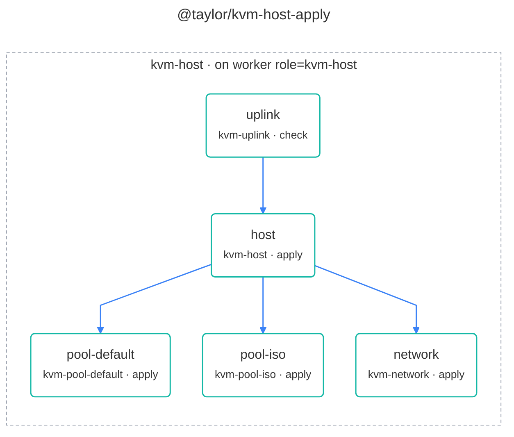
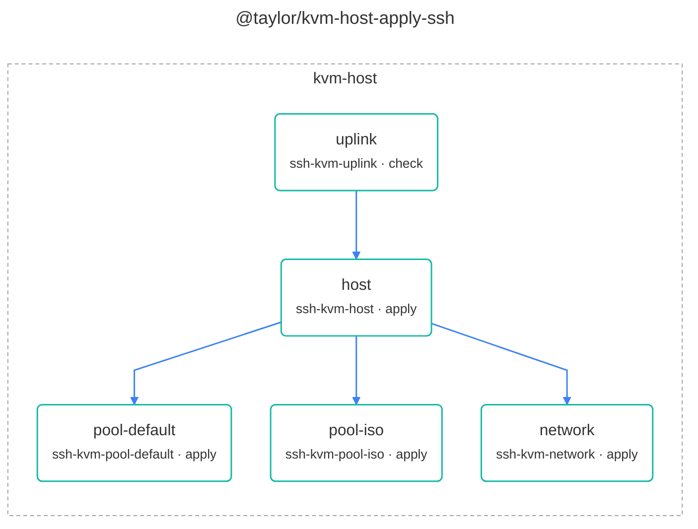
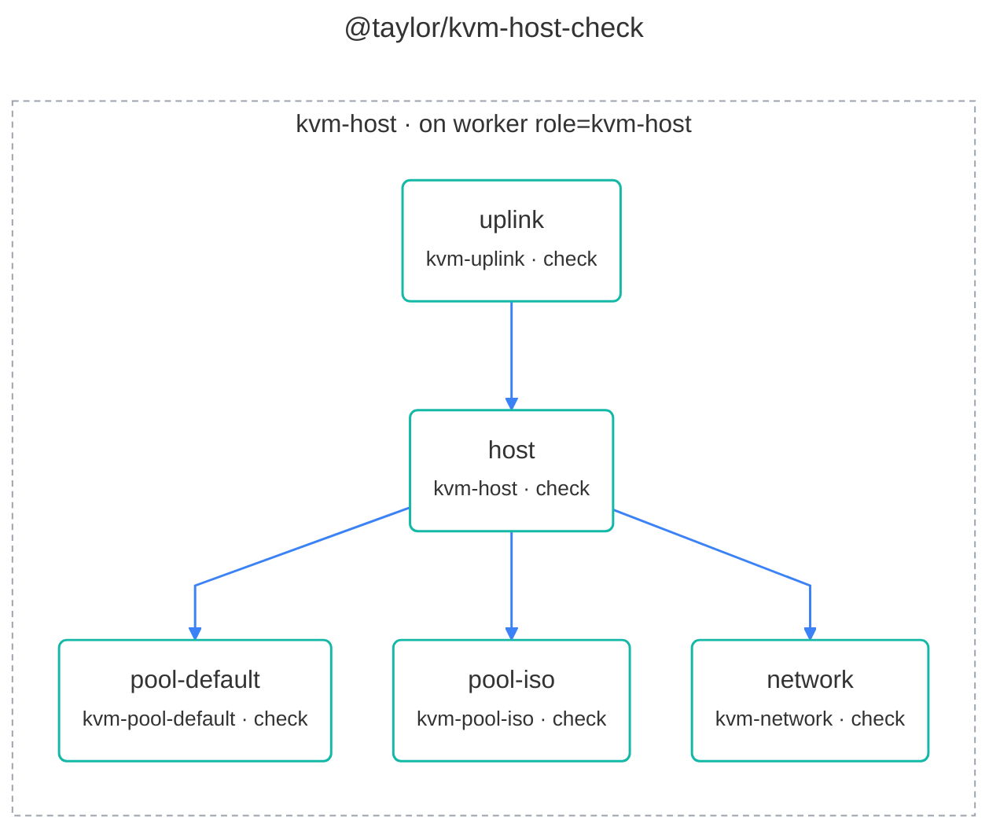
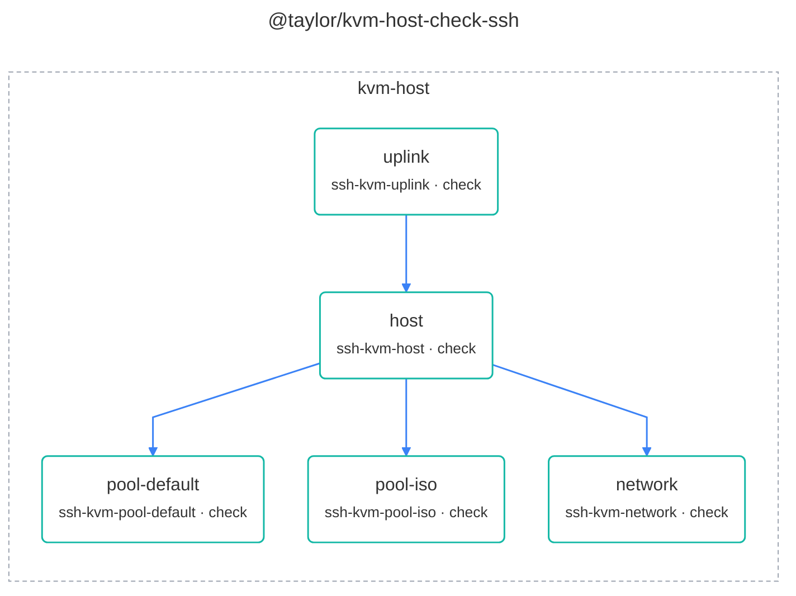
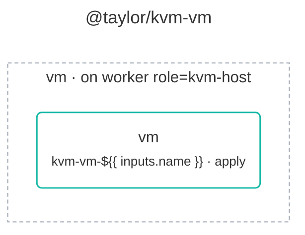
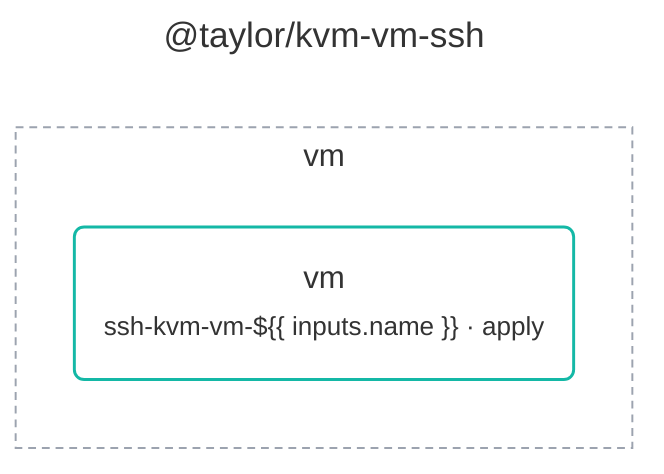

# @taylor/libvirt workflows

The [libvirt](../../libvirt/) extension sets up a KVM host and its VMs the way
the kvm-training deck does. Each workflow comes in two forms: one runs on the
KVM host itself through a swamp worker labelled `role=kvm-host`, and an `-ssh`
form runs wherever swamp runs and reaches the host over SSH, with nothing
installed on it. See the [legend](legend.md) for what the shapes and colours
mean.

## Set up a host

`@taylor/kvm-host-apply` checks first that guests can connect the chosen way
(the `uplink` step fails on, for example, Wi-Fi that can't be bridged), then
installs the packages and groups, and creates the image and ISO pools and the
libvirt network.

<!-- swamp-diagram: workflow-taylor-kvm-host-apply -->

<!-- /swamp-diagram -->

<!-- swamp-diagram: workflow-taylor-kvm-host-apply-ssh -->

<!-- /swamp-diagram -->

## Check a host

`@taylor/kvm-host-check` runs the same steps with `check` instead of `apply`,
and changes nothing.

<!-- swamp-diagram: workflow-taylor-kvm-host-check -->

<!-- /swamp-diagram -->

<!-- swamp-diagram: workflow-taylor-kvm-host-check-ssh -->

<!-- /swamp-diagram -->

## Create a VM

`@taylor/kvm-vm` creates, starts or removes an Ubuntu Server VM from the
release's cloud image and waits until it has an address.

<!-- swamp-diagram: workflow-taylor-kvm-vm -->

<!-- /swamp-diagram -->

<!-- swamp-diagram: workflow-taylor-kvm-vm-ssh -->

<!-- /swamp-diagram -->
