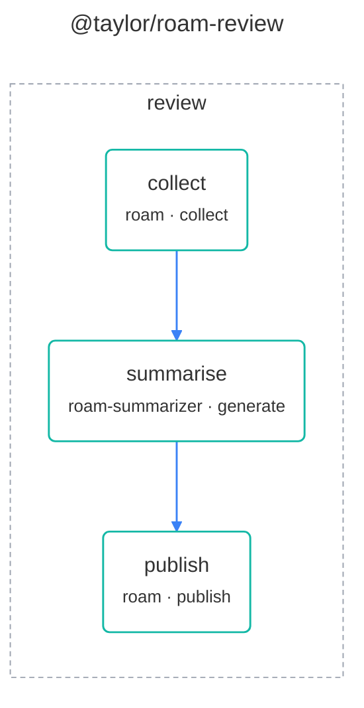

# @taylor/roam-graph workflow

`@taylor/roam-review` writes a periodic review for a Roam Research graph: a
weekly summary from the Activities on the daily notes, or a monthly, quarterly
or yearly rollup of the summaries below it. See the [legend](legend.md) for what
the shapes and colours mean.

<!-- swamp-diagram: workflow-taylor-roam-review -->

<!-- /swamp-diagram -->

`collect` gathers the period's sources and builds the prompt, `summarise` writes
the summary with Claude, and `publish` writes it to the graph as a heading block
on the daily note of the Monday after the period ends.
