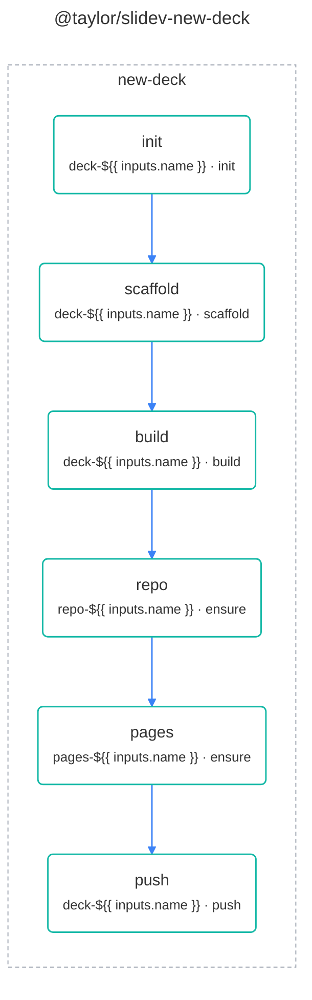

# @taylor/slidev workflow

`@taylor/slidev-new-deck` creates a Slidev deck and publishes it to GitHub
Pages. See the [legend](legend.md) for what the shapes and colours mean.

<!-- swamp-diagram: workflow-taylor-slidev-new-deck -->

<!-- /swamp-diagram -->

The deck is checked to build before anything is created on GitHub, and Pages is
set to build from GitHub Actions before the first push, so that push's deploy
succeeds.
