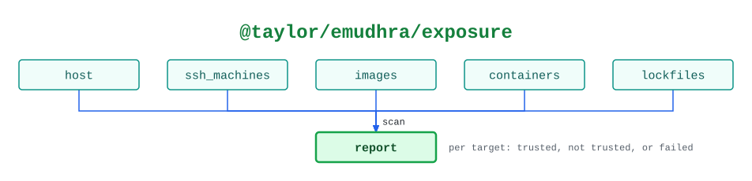

# @taylor/emudhra/exposure

One `scan` checks every target for trust in the eight compromised eMudhra
intermediate CAs, and changes nothing. A target that fails is reported and the
rest are still scanned.

See the [legend](../../swamp-diagrams/docs/legend.md) for what the shapes and
colours mean.

<!-- swamp-diagram: state-machine-taylor-emudhra-exposure -->

<picture>
  <source media="(prefers-color-scheme: dark)" srcset="diagrams/state-machine-taylor-emudhra-exposure-dark.svg">
  
</picture>

<!-- /swamp-diagram -->

## Transitions

The diagram is drawn from these lines. Each `from ──[method]──> to` means
running `method` in phase `from` leaves it in phase `to`.

```text
host ──[scan]──> report
ssh_machines ──[scan]──> report
images ──[scan]──> report
containers ──[scan]──> report
lockfiles ──[scan]──> report
```
