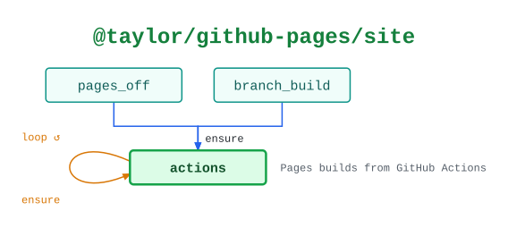

# @taylor/github-pages/site

Makes a repository's GitHub Pages site build from GitHub Actions.

See the [legend](../../swamp-diagrams/docs/legend.md) for what the shapes and
colours mean.

<!-- swamp-diagram: state-machine-taylor-github-pages-site -->

<picture>
  <source media="(prefers-color-scheme: dark)" srcset="diagrams/state-machine-taylor-github-pages-site-dark.svg">
  
</picture>

<!-- /swamp-diagram -->

## Transitions

The diagram is drawn from these lines. Each `from ──[method]──> to` means
running `method` in phase `from` leaves it in phase `to`.

```text
pages_off ──[ensure]──> actions
branch_build ──[ensure]──> actions
actions ──[ensure]──> actions
```
