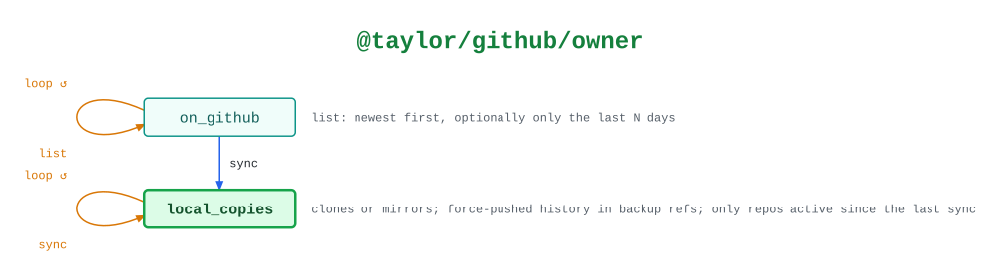

# @taylor/github/owner

A user's or organization's repositories, newest first, and local copies of them
kept up to date.

See the [legend](../../swamp-diagrams/docs/legend.md) for what the shapes and
colours mean.

<!-- swamp-diagram: state-machine-taylor-github-owner -->

<picture>
  <source media="(prefers-color-scheme: dark)" srcset="diagrams/state-machine-taylor-github-owner-dark.svg">
  
</picture>

<!-- /swamp-diagram -->

## Transitions

The diagram is drawn from these lines. Each `from ──[method]──> to` means
running `method` in phase `from` leaves it in phase `to`.

```text
on_github ──[list]──> on_github
on_github ──[sync]──> local_copies
local_copies ──[sync]──> local_copies
```
