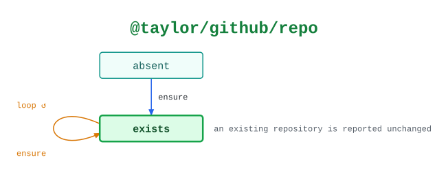

# @taylor/github/repo

Makes sure a GitHub repository exists, through the GitHub CLI's login.

See the [legend](../../swamp-diagrams/docs/legend.md) for what the shapes and
colours mean.

<!-- swamp-diagram: state-machine-taylor-github-repo -->

<picture>
  <source media="(prefers-color-scheme: dark)" srcset="diagrams/state-machine-taylor-github-repo-dark.svg">
  
</picture>

<!-- /swamp-diagram -->

## Transitions

The diagram is drawn from these lines. Each `from ──[method]──> to` means
running `method` in phase `from` leaves it in phase `to`.

```text
absent ──[ensure]──> exists
exists ──[ensure]──> exists
```
