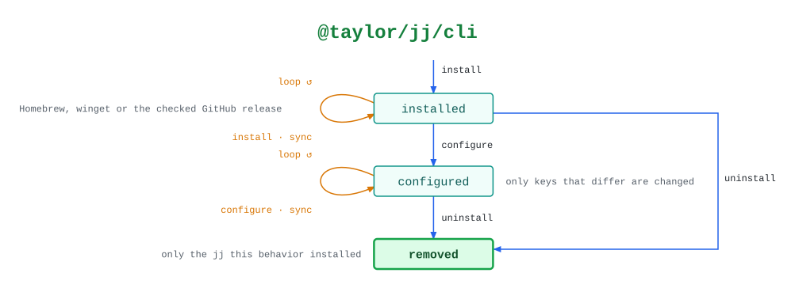

# @taylor/jj/cli

Installs Jujutsu and keeps its user config to the definition. `sync` only reads,
and records any drift from the arguments.

See the [legend](../../swamp-diagrams/docs/legend.md) for what the shapes and
colours mean.

<!-- swamp-diagram: state-machine-taylor-jj-cli -->

<picture>
  <source media="(prefers-color-scheme: dark)" srcset="diagrams/state-machine-taylor-jj-cli-dark.svg">
  
</picture>

<!-- /swamp-diagram -->

## Transitions

The diagram is drawn from these lines. Each `from ──[method]──> to` means
running `method` in phase `from` leaves it in phase `to`.

```text
absent ──[install]──> installed
installed ──[install]──> installed  (upgrade=true moves to the latest release)
installed ──[sync]──> installed
installed ──[configure]──> configured
configured ──[configure]──> configured
configured ──[sync]──> configured
configured ──[uninstall]──> removed
installed ──[uninstall]──> removed
```
