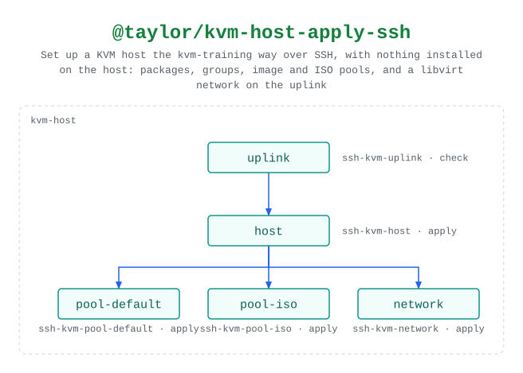

# @taylor/kvm-host-apply-ssh

Checks first that guests can connect the chosen way (the `uplink` step fails on,
for example, Wi-Fi that can't be bridged), then installs the packages and
groups, and creates the image and ISO pools and the libvirt network. Runs
wherever swamp runs and reaches the KVM host over SSH, with nothing installed on
the host.

Source:
[`workflows/workflow-kvm-host-apply-ssh.yaml`](../workflows/workflow-kvm-host-apply-ssh.yaml).
See the [legend](../../swamp-diagrams/docs/legend.md) for what the shapes and
colours mean.

<!-- swamp-diagram: workflow-taylor-kvm-host-apply-ssh -->

<picture>
  <source media="(prefers-color-scheme: dark)" srcset="diagrams/workflow-taylor-kvm-host-apply-ssh-dark.svg">
  
</picture>

<!-- /swamp-diagram -->
