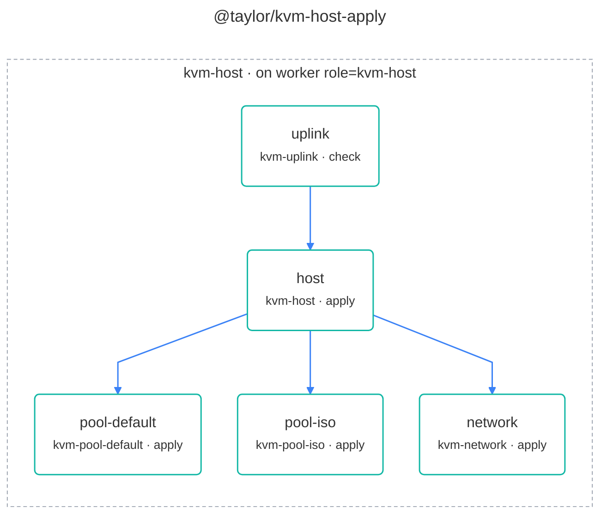

# @taylor/kvm-host-apply

Checks first that guests can connect the chosen way (the `uplink` step fails on,
for example, Wi-Fi that can't be bridged), then installs the packages and
groups, and creates the image and ISO pools and the libvirt network. Runs on the
KVM host itself, through a swamp worker labelled `role=kvm-host`.

Source:
[`workflows/workflow-kvm-host-apply.yaml`](../workflows/workflow-kvm-host-apply.yaml).
See the [legend](../../swamp-diagrams/docs/legend.md) for what the shapes and
colours mean.

<!-- swamp-diagram: workflow-taylor-kvm-host-apply -->

<!-- /swamp-diagram -->
