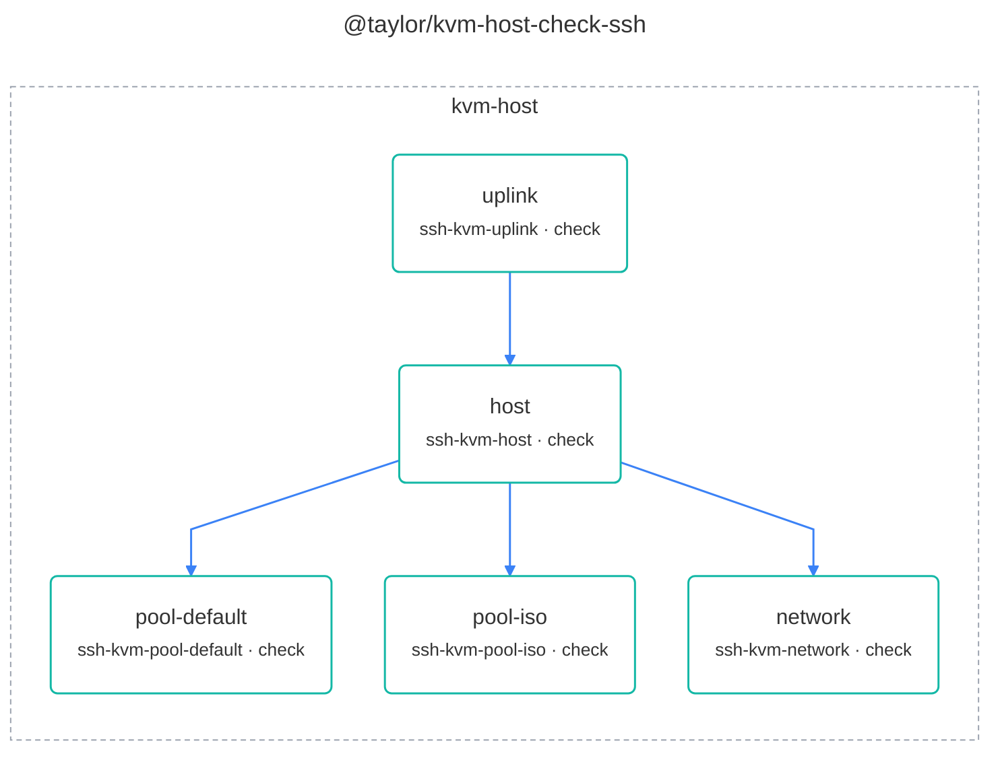

# @taylor/kvm-host-check-ssh

Runs the same steps as `kvm-host-apply` with `check` instead of `apply`, and
changes nothing. Runs wherever swamp runs and reaches the KVM host over SSH,
with nothing installed on the host.

Source:
[`workflows/workflow-kvm-host-check-ssh.yaml`](../workflows/workflow-kvm-host-check-ssh.yaml).
See the [legend](../../swamp-diagrams/docs/legend.md) for what the shapes and
colours mean.

<!-- swamp-diagram: workflow-taylor-kvm-host-check-ssh -->

<!-- /swamp-diagram -->
