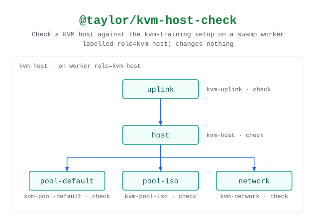

# @taylor/kvm-host-check

Runs the same steps as `kvm-host-apply` with `check` instead of `apply`, and
changes nothing. Runs on the KVM host itself, through a swamp worker labelled
`role=kvm-host`.

Source:
[`workflows/workflow-kvm-host-check.yaml`](../workflows/workflow-kvm-host-check.yaml).
See the [legend](../../swamp-diagrams/docs/legend.md) for what the shapes and
colours mean.

<!-- swamp-diagram: workflow-taylor-kvm-host-check -->

<picture>
  <source media="(prefers-color-scheme: dark)" srcset="diagrams/workflow-taylor-kvm-host-check-dark.svg">
  
</picture>

<!-- /swamp-diagram -->
