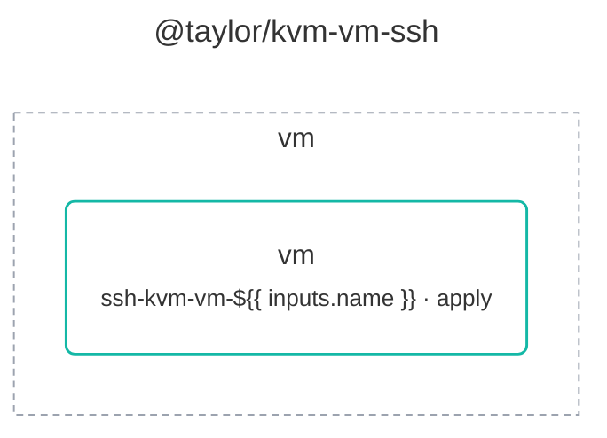

# @taylor/kvm-vm-ssh

Creates, starts or removes an Ubuntu Server VM from the release's cloud image
and waits until it has an address. Runs wherever swamp runs and reaches the KVM
host over SSH, with nothing installed on the host.

Source:
[`workflows/workflow-kvm-vm-ssh.yaml`](../workflows/workflow-kvm-vm-ssh.yaml).
See the [legend](../../swamp-diagrams/docs/legend.md) for what the shapes and
colours mean.

<!-- swamp-diagram: workflow-taylor-kvm-vm-ssh -->

<!-- /swamp-diagram -->
