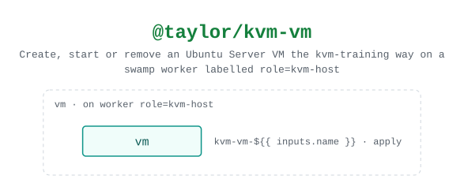

# @taylor/kvm-vm

Creates, starts or removes an Ubuntu Server VM from the release's cloud image
and waits until it has an address. Runs on the KVM host itself, through a swamp
worker labelled `role=kvm-host`.

Source: [`workflows/workflow-kvm-vm.yaml`](../workflows/workflow-kvm-vm.yaml).
See the [legend](../../swamp-diagrams/docs/legend.md) for what the shapes and
colours mean.

<!-- swamp-diagram: workflow-taylor-kvm-vm -->

<picture>
  <source media="(prefers-color-scheme: dark)" srcset="diagrams/workflow-taylor-kvm-vm-dark.svg">
  
</picture>

<!-- /swamp-diagram -->
