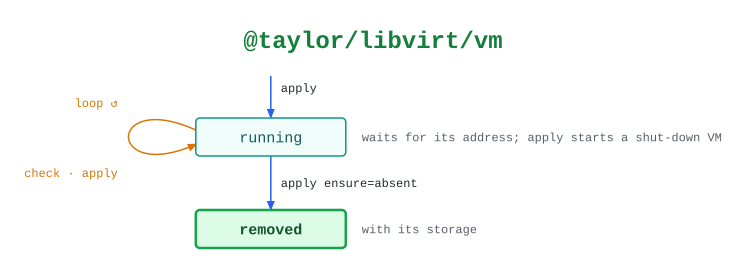

# @taylor/libvirt/vm

An Ubuntu Server VM from the release's cloud image. The host, pool, network and
uplink behaviors follow the same `check` / `apply` pattern, and the
[workflows](README.md) run them in order.

See the [legend](../../swamp-diagrams/docs/legend.md) for what the shapes and
colours mean.

<!-- swamp-diagram: state-machine-taylor-libvirt-vm -->

<picture>
  <source media="(prefers-color-scheme: dark)" srcset="diagrams/state-machine-taylor-libvirt-vm-dark.svg">
  
</picture>

<!-- /swamp-diagram -->

## Transitions

The diagram is drawn from these lines. Each `from ──[method]──> to` means
running `method` in phase `from` leaves it in phase `to`.

```text
absent ──[apply]──> running
running ──[check]──> running
running ──[apply]──> running
running ──[apply ensure=absent]──> removed
```
