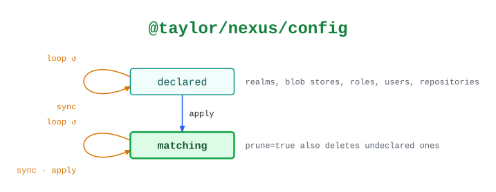

# @taylor/nexus/config

Declares what goes in a Nexus instance: realms, blob stores, roles, users and
repositories. `sync` only reads, and records what `apply` would change.

See the [legend](../../swamp-diagrams/docs/legend.md) for what the shapes and
colours mean.

<!-- swamp-diagram: state-machine-taylor-nexus-config -->

<picture>
  <source media="(prefers-color-scheme: dark)" srcset="diagrams/state-machine-taylor-nexus-config-dark.svg">
  
</picture>

<!-- /swamp-diagram -->

## Transitions

The diagram is drawn from these lines. Each `from ──[method]──> to` means
running `method` in phase `from` leaves it in phase `to`.

```text
declared ──[sync]──> declared
declared ──[apply]──> matching
matching ──[sync]──> matching
matching ──[apply]──> matching
```
