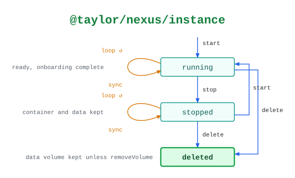

# @taylor/nexus/instance

Runs Sonatype Nexus Repository with Docker or Apple's container CLI. `sync` only
reads, and records any drift from the arguments.

See the [legend](../../swamp-diagrams/docs/legend.md) for what the shapes and
colours mean.

<!-- swamp-diagram: state-machine-taylor-nexus-instance -->

<picture>
  <source media="(prefers-color-scheme: dark)" srcset="diagrams/state-machine-taylor-nexus-instance-dark.svg">
  
</picture>

<!-- /swamp-diagram -->

## Transitions

The diagram is drawn from these lines. Each `from ──[method]──> to` means
running `method` in phase `from` leaves it in phase `to`.

```text
absent ──[start]──> running
running ──[sync]──> running
running ──[stop]──> stopped
stopped ──[sync]──> stopped
stopped ──[start]──> running
stopped ──[delete]──> deleted
running ──[delete]──> deleted
```
