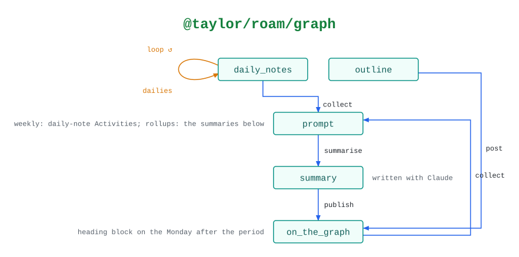

# @taylor/roam/graph

How the periodic reviews flow through the graph. The `@taylor/roam-review`
workflow runs `collect`, writes the summary with Claude, and runs `publish`.

See the [legend](../../swamp-diagrams/docs/legend.md) for what the shapes and
colours mean.

<!-- swamp-diagram: state-machine-taylor-roam-graph -->

<picture>
  <source media="(prefers-color-scheme: dark)" srcset="diagrams/state-machine-taylor-roam-graph-dark.svg">
  
</picture>

<!-- /swamp-diagram -->

## Transitions

The diagram is drawn from these lines. Each `from ──[method]──> to` means
running `method` in phase `from` leaves it in phase `to`.

```text
daily_notes ──[dailies]──> daily_notes
daily_notes ──[collect]──> prompt
prompt ──[summarise]──> summary
summary ──[publish]──> on_the_graph
on_the_graph ──[collect]──> prompt
outline ──[post]──> on_the_graph
```
