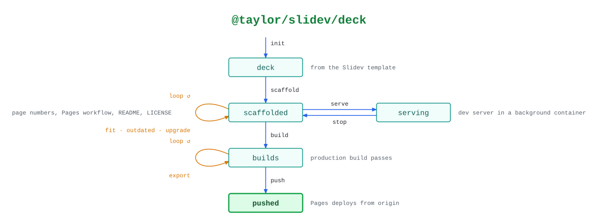

# @taylor/slidev/deck

A Slidev deck worked on entirely inside a container. `fit`, `outdated` and
`export` only read the deck.

See the [legend](../../swamp-diagrams/docs/legend.md) for what the shapes and
colours mean.

<!-- swamp-diagram: state-machine-taylor-slidev-deck -->

<picture>
  <source media="(prefers-color-scheme: dark)" srcset="diagrams/state-machine-taylor-slidev-deck-dark.svg">
  
</picture>

<!-- /swamp-diagram -->

## Transitions

The diagram is drawn from these lines. Each `from ──[method]──> to` means
running `method` in phase `from` leaves it in phase `to`.

```text
none ──[init]──> deck
deck ──[scaffold]──> scaffolded
scaffolded ──[fit]──> scaffolded
scaffolded ──[outdated]──> scaffolded
scaffolded ──[upgrade]──> scaffolded
scaffolded ──[serve]──> serving
serving ──[stop]──> scaffolded
scaffolded ──[build]──> builds
builds ──[export]──> builds
builds ──[push]──> pushed
```
