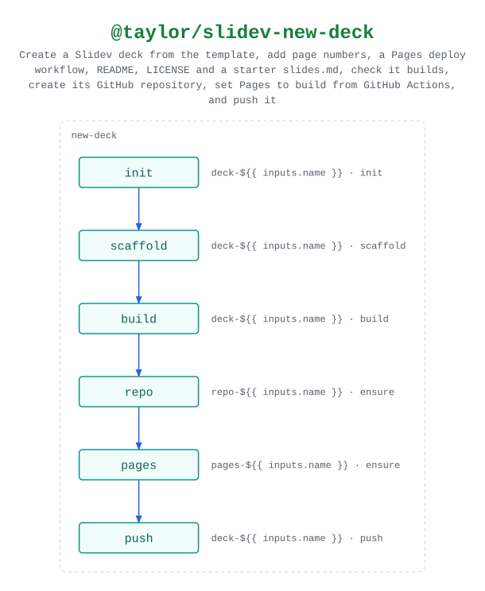

# @taylor/slidev-new-deck

Creates a Slidev deck and publishes it to GitHub Pages.

Source:
[`workflows/workflow-slidev-new-deck.yaml`](../workflows/workflow-slidev-new-deck.yaml).
See the [legend](../../swamp-diagrams/docs/legend.md) for what the shapes and
colours mean.

<!-- swamp-diagram: workflow-taylor-slidev-new-deck -->

<picture>
  <source media="(prefers-color-scheme: dark)" srcset="diagrams/workflow-taylor-slidev-new-deck-dark.svg">
  
</picture>

<!-- /swamp-diagram -->

The deck is checked to build before anything is created on GitHub, and Pages is
set to build from GitHub Actions before the first push, so that push's deploy
succeeds.
