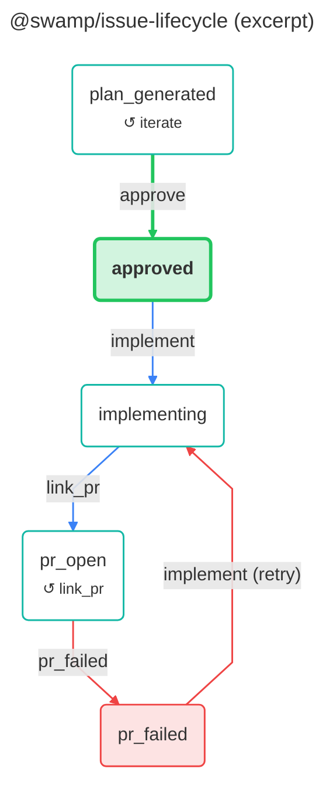

# swamp-diagrams

A [swamp](https://swamp.club/) extension that draws diagrams of swamp workflows
and of behaviors' state machines, as [Mermaid](https://mermaid.js.org/).

- `workflow` draws workflows as flowcharts: a box per job, a node per step, and
  `dependsOn` arrows labelled with their condition.
- `stateMachine` draws a behavior's phases and the methods that move between
  them, from the transition lines in a published extension's description (as
  [@swamp/issue-lifecycle](https://swamp-club.com/extensions/@swamp/issue-lifecycle)
  has) or from lines you pass in.

GitHub draws Mermaid in Markdown itself, so the default `auto` theme leaves the
base colours to the reader's light or dark mode and only adds colours that read
on both. Diagrams can be written straight into marked blocks in your docs, and
rendered to SVG or PNG for anywhere else.



## Behavior

`@taylor/swamp-diagrams/diagram`:

| Global argument | Default                               | Description                                                                                                             |
| --------------- | ------------------------------------- | ----------------------------------------------------------------------------------------------------------------------- |
| `theme`         | `auto`                                | `auto` (reads in light and dark mode), `dark`, `light`, `both` (auto source, images as a `-dark`/`-light` pair), `none` |
| `direction`     | `TD`                                  | `TD` (top-down) or `LR` (left-to-right)                                                                                 |
| `embedIn`       |                                       | Markdown file or folder whose `swamp-diagram` blocks get the diagram                                                    |
| `render`        | `none`                                | Also render `svg` or `png` with the mermaid-cli container (needs Docker)                                                |
| `outputDir`     |                                       | Folder, relative to the repository, to also copy the diagram files into                                                 |
| `copyFiles`     | `["mmd", "md", "image"]`              | Which files to copy into `outputDir`                                                                                    |
| `registryUrl`   | `https://swamp-club.com`              | Registry that `stateMachine` reads extension descriptions from                                                          |
| `dockerPath`    | `docker`                              | Docker CLI binary                                                                                                       |
| `mermaidImage`  | `minlag/mermaid-cli:11.12.0@sha256:…` | mermaid-cli image, pinned by digest                                                                                     |

| Method         | What it does                                                                                                                   |
| -------------- | ------------------------------------------------------------------------------------------------------------------------------ |
| `workflow`     | Draw one workflow (`name` or `path`) or every workflow in `dir` (default `workflows/`) and the `workflows/` folders beneath it |
| `stateMachine` | Draw a behavior's phases from `extension` (its registry description) or from `transitions` text                                |

Each run writes a `diagram` resource (the Mermaid source, what it was drawn
from, and where it was copied or embedded) and `mermaid` and `markdown` files,
plus `image` files when rendering. Diagrams are named `workflow-<name>` and
`state-machine-<extension>`.

### Diagrams in your docs

Put a marker pair where a diagram belongs:

```markdown
<!-- swamp-diagram: workflow-taylor-kvm-vm -->
<!-- /swamp-diagram -->
```

With `embedIn` set to the file or folder, each run replaces what's between the
markers with the current diagram in a `mermaid` code block, and leaves the prose
around them alone. A run that changes nothing leaves the file untouched.

### Workflows

Steps show the behavior and method they run, and a job's worker labels say where
it runs. Manual approvals and signal waits are green hexagons, nested workflows
are double-sided boxes, and steps with `allowFailure` have a dashed border. A
`failed` dependency is a red arrow; `completed` and other conditions are dotted
grey arrows with the condition as the label.

### State machines

The transition notation is the one swamp extensions use in their descriptions:

```
created ──[start]──> triaging
plan_generated ──[iterate]──> plan_generated  (feedback loop)
```

ASCII arrows (`a --[method]--> b`) work too, and lines that don't match are
ignored, so a whole description or README can be passed in. A method that keeps
a phase where it is shows as `↺ method` in the phase's box. Steps back to an
earlier phase are red and labelled `(retry)`, phases whose name contains `fail`
are red, and final phases are green.

| Argument          | Description                                                                           |
| ----------------- | ------------------------------------------------------------------------------------- |
| `extension`       | Published extension whose description holds the transitions                           |
| `transitions`     | Transition lines to draw instead                                                      |
| `title`           | Diagram title (defaults to the extension name)                                        |
| `subtitle`        | A line under the title in the Markdown file                                           |
| `hideStates`      | Phases to leave out; their transitions become entry or exit dots                      |
| `collapseStates`  | Phases to skip over: each way in is joined to each way out, under the outgoing method |
| `omitMethods`     | Methods whose transitions are left out                                                |
| `humanGates`      | Methods only a person may run, drawn as thick green arrows                            |
| `highlightStates` | Phases to emphasise besides the final ones                                            |
| `failureStates`   | Phases to draw as failures besides those named `*fail*`                               |
| `notes`           | A short note under a phase, keyed by phase                                            |
| `showComments`    | Add each transition's parenthetical comment to its arrow                              |

## Usage

```sh
swamp extension pull @taylor/swamp-diagrams
swamp behavior create @taylor/swamp-diagrams/diagram diagrams \
  --global-arg embedIn=docs

# Every workflow in workflows/
swamp behavior run diagrams workflow

# Every workflows/ folder in a monorepo of extensions, from one of them
swamp behavior run diagrams workflow --input dir=..

# @swamp/issue-lifecycle's state machine, on its main path
swamp behavior run diagrams stateMachine \
  --input extension=@swamp/issue-lifecycle \
  --input 'humanGates=["approve"]' \
  --input 'hideStates=["created"]' \
  --input 'collapseStates=["verifying"]' \
  --input 'omitMethods=["complete"]'
```

For an image instead, add `--global-arg render=svg` (or `png`) and
`--global-arg outputDir=<folder>`; `theme=both` renders a `-dark` and `-light`
pair for a `<picture>` element. Rendering runs the digest-pinned mermaid-cli
image with Docker, the extension's only subprocess; a `docker-available`
pre-flight check stops the run early, with a clear message, when Docker isn't
there or its daemon isn't running.

Read a diagram back:

```sh
swamp data query 'modelName == "diagrams" && name == "state-machine-swamp-issue-lifecycle"' \
  --select content
```

[swampworks/docs](https://github.com/taylorific/swampworks/tree/main/docs) is
kept up to date this way.

## License

AGPL-3.0-or-later with the Swamp Extension and Definition Exception; see
[LICENSE](LICENSE), [COPYING](COPYING) and
[COPYING-EXCEPTION](COPYING-EXCEPTION).
