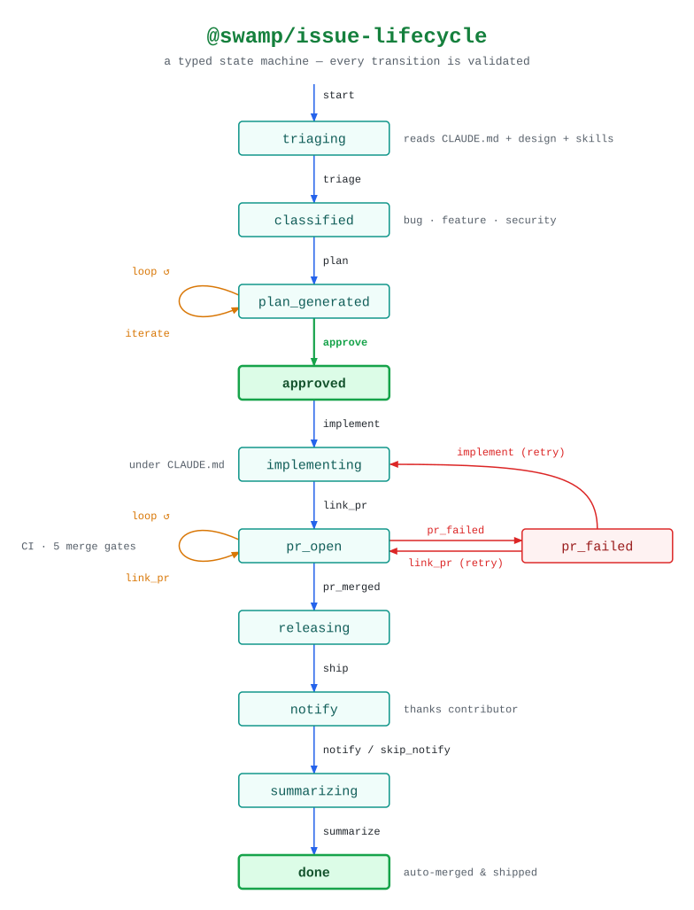

# swamp-diagrams

A [swamp](https://swamp.club/) extension that draws diagrams of swamp workflows
and of behaviors' state machines.

- `workflow` draws workflows: a frame per job, a box per step, and `dependsOn`
  arrows labelled with their condition.
- `stateMachine` draws a behavior's phases and the methods that move between
  them, from the transition lines in a published extension's description (as
  [@swamp/issue-lifecycle](https://swamp-club.com/extensions/@swamp/issue-lifecycle)
  has) or from lines you pass in.

By default each diagram is a light and a dark SVG with a fixed layout: the main
path runs straight down the middle, failures sit beside the phase that leads to
them, retries curve back up, loops are arcs on the left, and notes sit beside
their box. Text is monospace, so every box is sized to its label without a
browser. Diagrams are written straight into marked blocks in your docs as a
`<picture>` that follows the reader's light or dark theme. Set `format=mermaid`
for Mermaid instead, which GitHub draws itself.

<picture>
  <source media="(prefers-color-scheme: dark)" srcset="https://raw.githubusercontent.com/taylorific/swampworks/main/swamp-diagrams/docs/diagrams/state-machine-swamp-issue-lifecycle-dark.svg">
  
</picture>

## Behavior

`@taylor/swamp-diagrams/diagram`:

| Global argument | Default                               | Description                                                                                                              |
| --------------- | ------------------------------------- | ------------------------------------------------------------------------------------------------------------------------ |
| `format`        | `svg`                                 | `svg` (a light and dark SVG pair with the fixed layout) or `mermaid`                                                     |
| `theme`         | `auto`                                | Mermaid only: `auto` (reads in light and dark mode), `dark`, `light`, `both` (images as a `-dark`/`-light` pair), `none` |
| `direction`     | `TD`                                  | `TD` (top-down) or `LR` (left-to-right)                                                                                  |
| `embedIn`       |                                       | Markdown file or folder whose `swamp-diagram` blocks get the diagram                                                     |
| `render`        | `none`                                | Mermaid only: also render `svg` or `png` with the mermaid-cli container (needs Docker)                                   |
| `outputDir`     |                                       | Folder, relative to the repository, to also copy the diagram files into                                                  |
| `copyFiles`     | `["mmd", "md", "image"]`              | Which files to copy into `outputDir`                                                                                     |
| `registryUrl`   | `https://swamp-club.com`              | Registry that `stateMachine` reads extension descriptions from                                                           |
| `dockerPath`    | `docker`                              | Docker CLI binary                                                                                                        |
| `mermaidImage`  | `minlag/mermaid-cli:11.12.0@sha256:…` | mermaid-cli image, pinned by digest                                                                                      |

| Method         | What it does                                                                                                                   |
| -------------- | ------------------------------------------------------------------------------------------------------------------------------ |
| `workflow`     | Draw one workflow (`name` or `path`) or every workflow in `dir` (default `workflows/`) and the `workflows/` folders beneath it |
| `stateMachine` | Draw a behavior's phases from `extension` (its registry description) or from `transitions` text                                |

Each run writes a `diagram` resource (the Mermaid source, what it was drawn
from, and where it was copied or embedded), `mermaid` and `markdown` files, and
`image` files: the SVG pair, or mermaid-cli's render. Diagrams are named
`workflow-<name>` and `state-machine-<extension>`.

### Diagrams in your docs

Put a marker pair where a diagram belongs:

```markdown
<!-- swamp-diagram: workflow-taylor-kvm-vm -->
<!-- /swamp-diagram -->
```

With `embedIn` set to the file or folder, each run replaces what's between the
markers with the current diagram and leaves the prose around them alone. With
`format=svg` that is a `<picture>` of the pair, saved as
`diagrams/<name>-dark.svg` and `-light.svg` beside the page; with
`format=mermaid` it is a `mermaid` code block. Markers inside code blocks, like
the ones above, are left alone, and a run that changes nothing leaves every file
untouched.

### Workflows

Each step has the behavior and method it runs beside its box, and each job's
frame says which worker runs it. Steps a person acts on (manual approvals,
signal waits) are green, steps that run another workflow have a double border,
and steps with `allowFailure` a dashed one. A `failed` dependency is a red
arrow; `completed` and other conditions are dashed grey arrows labelled with the
condition. (In Mermaid, approvals are hexagons and nested workflows double-sided
boxes.)

### State machines

The transition notation is the one swamp extensions use in their descriptions:

```
created ──[start]──> triaging
plan_generated ──[iterate]──> plan_generated  (feedback loop)
```

ASCII arrows (`a --[method]--> b`) work too, and lines that don't match are
ignored, so a whole description or README can be passed in. A method that keeps
a phase where it is is an amber loop beside the phase (in Mermaid, a `↺ method`
line in its box). Steps back to an earlier phase are red and labelled `(retry)`,
phases whose name contains `fail` are red, and final phases are green.

| Argument          | Description                                                                                 |
| ----------------- | ------------------------------------------------------------------------------------------- |
| `extension`       | Published extension whose description holds the transitions                                 |
| `transitions`     | Transition lines to draw instead                                                            |
| `title`           | Diagram title (defaults to the extension name)                                              |
| `subtitle`        | A line under the title in the Markdown file                                                 |
| `hideStates`      | Phases to leave out; their transitions become entry or exit dots                            |
| `collapseStates`  | Phases to skip over: each way in is joined to each way out, under the outgoing method       |
| `omitMethods`     | Methods whose transitions are left out                                                      |
| `humanGates`      | Methods only a person may run, drawn as thick green arrows                                  |
| `highlightStates` | Phases to emphasise besides the final ones                                                  |
| `failureStates`   | Phases to draw as failures besides those named `*fail*`                                     |
| `notes`           | A short note under a phase, keyed by phase                                                  |
| `showComments`    | Add each transition's parenthetical comment to its arrow                                    |
| `path`            | A file to read the transition lines from, such as the docs page itself                      |
| `backEdges`       | `retry` (red, labelled `(retry)`) or `normal`, for routine steps back like start after stop |

## Usage

```sh
swamp extension pull @taylor/swamp-diagrams
swamp behavior create @taylor/swamp-diagrams/diagram diagrams \
  --global-arg embedIn=docs

# Every workflow in workflows/
swamp behavior run diagrams workflow

# Every workflows/ folder in a monorepo of extensions, from one of them
swamp behavior run diagrams workflow --input dir=..

# @swamp/issue-lifecycle's state machine, on its main path
swamp behavior run diagrams stateMachine \
  --input extension=@swamp/issue-lifecycle \
  --input 'humanGates=["approve"]' \
  --input 'hideStates=["created"]' \
  --input 'collapseStates=["verifying"]' \
  --input 'omitMethods=["complete"]'
```

To copy the files somewhere else as well, set `--global-arg outputDir=<folder>`.
With `format=mermaid`, `--global-arg render=svg` (or `png`) also renders
Mermaid's own image; rendering runs the digest-pinned mermaid-cli image with
Docker, the extension's only subprocess; a `docker-available` pre-flight check
stops the run early, with a clear message, when Docker isn't there or its daemon
isn't running.

Read a diagram back:

```sh
swamp data query 'modelName == "diagrams" && name == "state-machine-swamp-issue-lifecycle"' \
  --select content
```

In [swampworks](https://github.com/taylorific/swampworks), each extension's
`docs/` folder (for example
[libvirt/docs](https://github.com/taylorific/swampworks/tree/main/libvirt/docs))
is kept up to date this way, by one definition with `embedIn=..` and
`scripts/update-diagrams.sh`.

## License

AGPL-3.0-or-later with the Swamp Extension and Definition Exception; see
[LICENSE](LICENSE), [COPYING](COPYING) and
[COPYING-EXCEPTION](COPYING-EXCEPTION).
