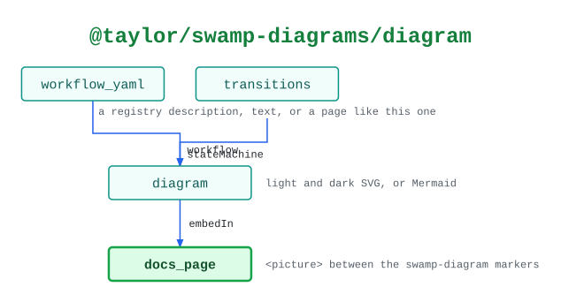

# @taylor/swamp-diagrams/diagram

Where each diagram comes from and where it goes.

See the [legend](../../swamp-diagrams/docs/legend.md) for what the shapes and
colours mean.

<!-- swamp-diagram: state-machine-taylor-swamp-diagrams-diagram -->

<picture>
  <source media="(prefers-color-scheme: dark)" srcset="diagrams/state-machine-taylor-swamp-diagrams-diagram-dark.svg">
  
</picture>

<!-- /swamp-diagram -->

## Transitions

The diagram is drawn from these lines. Each `from ──[method]──> to` means
running `method` in phase `from` leaves it in phase `to`.

```text
workflow_yaml ──[workflow]──> diagram
transitions ──[stateMachine]──> diagram
diagram ──[embedIn]──> docs_page
```
