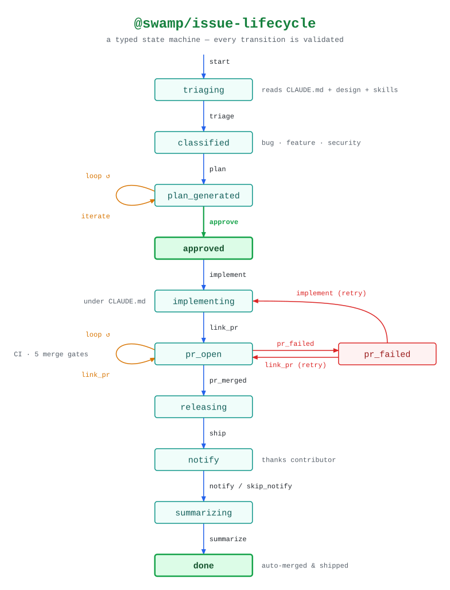

# @swamp/issue-lifecycle

[@swamp/issue-lifecycle](https://swamp-club.com/extensions/@swamp/issue-lifecycle)
drives a swamp-club issue from triage to a shipped release as a typed state
machine: every method checks the issue's current phase first, so a phase can't
be skipped. See the [legend](legend.md) for what the shapes and colours mean.

<!-- swamp-diagram: state-machine-swamp-issue-lifecycle -->

<picture>
  <source media="(prefers-color-scheme: dark)" srcset="diagrams/state-machine-swamp-issue-lifecycle-dark.svg">
  
</picture>

<!-- /swamp-diagram -->

The diagram is drawn from the transition list in the extension's published
description, simplified to the main path: `created` is shown as the entry dot,
`verifying` is folded into the `link_pr` arrow, and the `complete` shortcuts
(which end a lifecycle without a PR) are left out.

- **A person approves the plan.** `approve` is the one transition the agent
  never makes on its own; `iterate` revises the plan, and adversarial review
  findings must be resolved before it is allowed.
- **A failed PR goes back to work.** From `pr_failed`, `link_pr` opens a new PR
  or `implement` restarts the implementation.
- **The issue's reporter is thanked** in `notify` (or that step is skipped)
  before the session is summarised.
