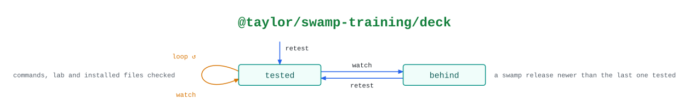

# @taylor/swamp-training/deck

Keeps the swamp-training deck honest about swamp: `watch` looks for a newer
release, and `retest` checks the deck against it.

See the [legend](../../swamp-diagrams/docs/legend.md) for what the shapes and
colours mean.

<!-- swamp-diagram: state-machine-taylor-swamp-training-deck -->

<picture>
  <source media="(prefers-color-scheme: dark)" srcset="diagrams/state-machine-taylor-swamp-training-deck-dark.svg">
  
</picture>

<!-- /swamp-diagram -->

## Transitions

The diagram is drawn from these lines. Each `from ──[method]──> to` means
running `method` in phase `from` leaves it in phase `to`.

```text
untested ──[retest]──> tested
tested ──[watch]──> tested
tested ──[watch]──> behind
behind ──[retest]──> tested
```
