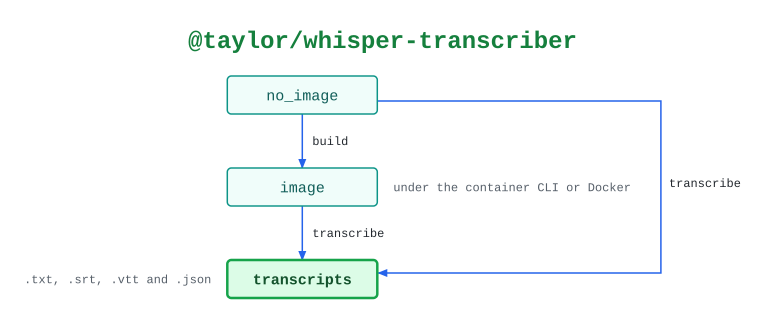

# @taylor/whisper-transcriber

Transcribes audio locally with faster-whisper in a container, so the audio never
leaves the machine.

See the [legend](../../swamp-diagrams/docs/legend.md) for what the shapes and
colours mean.

<!-- swamp-diagram: state-machine-taylor-whisper-transcriber -->

<picture>
  <source media="(prefers-color-scheme: dark)" srcset="diagrams/state-machine-taylor-whisper-transcriber-dark.svg">
  
</picture>

<!-- /swamp-diagram -->

## Transitions

The diagram is drawn from these lines. Each `from ──[method]──> to` means
running `method` in phase `from` leaves it in phase `to`.

```text
no_image ──[build]──> image
image ──[transcribe]──> transcripts
no_image ──[transcribe]──> transcripts
```
