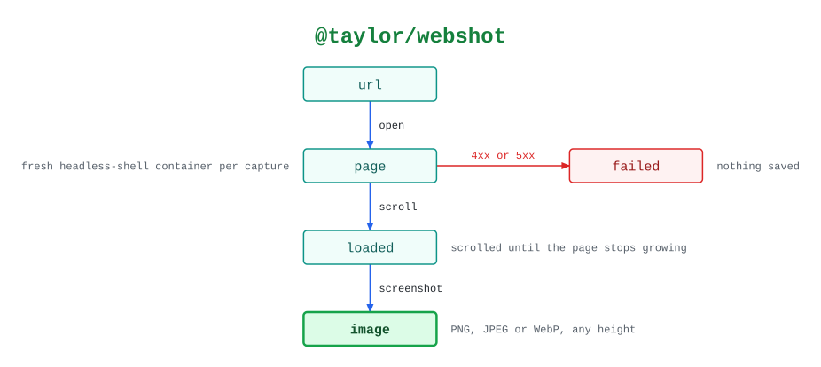

# @taylor/webshot

What one `capture` does: a full-page screenshot, scrolled to the bottom first so
lazy-loaded content is in it.

See the [legend](../../swamp-diagrams/docs/legend.md) for what the shapes and
colours mean.

<!-- swamp-diagram: state-machine-taylor-webshot -->

<picture>
  <source media="(prefers-color-scheme: dark)" srcset="diagrams/state-machine-taylor-webshot-dark.svg">
  
</picture>

<!-- /swamp-diagram -->

## Transitions

The diagram is drawn from these lines. Each `from ──[method]──> to` means
running `method` in phase `from` leaves it in phase `to`.

```text
url ──[open]──> page
page ──[4xx or 5xx]──> failed
page ──[scroll]──> loaded
loaded ──[screenshot]──> image
```
